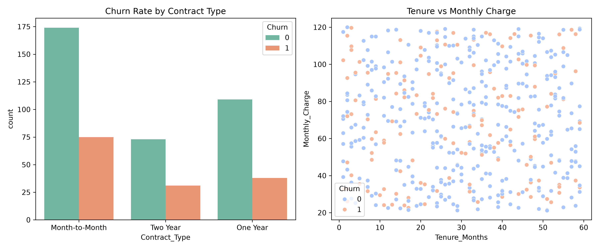

# 📊 Customer Retention & Churn Analysis

An end-to-end data analytics project focused on analyzing customer attrition patterns, tenure dynamics, and contract performance for a subscription-based business model.

---

## 📌 Business Overview
Customer churn is a critical KPI for subscription services. This project identifies key drivers of churn, evaluates high-risk customer segments based on monthly charges and contract terms, and provides visual insights to improve customer retention strategies.

---

## 🛠️ Tech Stack & Tools Used
* **Programming Language:** Python 3.x
* **Data Manipulation:** Pandas, NumPy
* **Data Visualization:** Seaborn, Matplotlib
* **Development Environment:** Visual Studio Code
* **Version Control:** Git & GitHub

---

## 📊 Visual Dashboard


---

## 💡 Key Analytical Insights
* **Contract Impact:** Customers on **Month-to-Month** contracts exhibit significantly higher churn rates compared to long-term (1-Year / 2-Year) subscribers.
* **Price Sensitivity:** Higher monthly charges coupled with lower tenure (0–15 months) mark the highest churn vulnerability zone.
* **Retention Opportunity:** Converting short-term users to annual plans serves as a key retention lever.

---

## 📁 Repository Structure
```text
FUTURE_DS_02/
├── task2_Churn.py            # Python analysis script
├── task2_churn_dashboard.png  # Generated dashboard visualization
└── README.md                 # Project documentation
```

---

## 🚀 How to Run the Project

```bash
# 1. **Clone the repository:**
git clone [https://github.com/mishraabhay83/FUTURE_DS_02.git](https://github.com/mishraabhay83/FUTURE_DS_02.git)
```

## 📂 Navigate to project directory:
```bash
cd FUTURE_DS_02
```

---

## ⚙️ Install required libraries:
```bash
pip install pandas numpy matplotlib seaborn
```

---

## 🚀 Run the churn analysis script:
```bash
python task2_Churn.py
```


